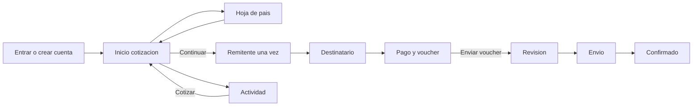

# Few, prototipo web de remesas

App web en español, fiel al flujo redibujado en Figma. El dinero es simulado. El dominio es real. Solo funciona Perú hacia Europa.

Todas las pantallas llevan la barra negra de arriba: **Few** a la izquierda y el icono de menú a la derecha. Sin sesión, ese menú abre una hoja corta de cómo funciona: cotiza, paga y sube el voucher. Con sesión, la misma hoja muestra el correo y, si ya existen, el nombre, el DNI y el celular, en solo lectura, más **Cerrar sesión**. No repite Inicio ni Actividad.

## Flujo

La barra inferior solo tiene **Inicio** y **Actividad**, y solo aparece en esas dos pantallas. El país no es otra página: es una hoja que cubre la cotización. **Continuar** abre al remitente la primera vez y, si esos datos ya existen, abre directo al destinatario.

## Pantallas

- **Entrar.** «¡Qué bueno volver a verte!», ilustración, Continuar con Google, correo, contraseña y **Entrar**. El enlace inferior lleva a crear cuenta.
- **Crear cuenta.** «Crea tu cuenta.» y «Transfiere dinero al instante entre Perú y Europa». Google, correo, contraseña y **Crear cuenta**. El enlace dice **Ingresar**.
- **Inicio.** «Hola {nombre}!» y «¿Cuánto enviamos hoy?». El control Europa → Perú se ve y no se puede elegir. Tú envías, ellos reciben, tipo, comisión, total y **Tipo bloqueado**. **Continuar** queda encima de la barra Inicio / Actividad.
- **País.** Hoja inferior sobre el inicio: «¿A qué país?», buscador de 10 países y cierre con X. Elegir un país cierra la hoja y recalcula la cotización.
- **Remitente.** Paso 1 de 6. «¿Quién envía?». Campos vacíos con ejemplo: nombre, DNI y celular. Se pide una sola vez.
- **Destinatario.** Paso 2 de 6, en dos estados. Con gente guardada de ese país: lista, la persona elegida marcada y el botón oscuro **Nuevo destinatario**. El formulario nuevo pide nombre e IBAN, con el ejemplo de IBAN español, y no muestra la lista a la vez.
- **Pago y voucher.** Paso 3 de 6. Título «Paga y envía.». Monto exacto, banco, cuenta, referencia y la zona para subir el archivo. **Enviar voucher**.
- **Revisión.** Paso 4 de 6. «Revisando tu voucher.» Remitente, destinatario y pago en **Listo**; revisión **En curso**; envío **Pendiente**.
- **Envío.** Paso 5 de 6, fondo lima. Revisión en **Listo** y envío **En curso**.
- **Confirmado.** Paso 6 de 6. **Enviar de nuevo** y **Descargar recibo**.
- **Actividad.** «Últimos envíos» y, debajo, la tarjeta negra «Envía dinero a casa» con **Cotizar**, que vuelve al inicio. Una fila abre el paso en el que está ese envío.

Los pasos 1 a 3 tienen flecha para volver. Revisión, envío y confirmado no la tienen: el estado avanza solo.

## Reglas que se mantienen

- Acceso con Google o con email y contraseña. El registro no pide nombre, DNI ni celular. Supabase no exige confirmar el email.
- Nombre, DNI de 8 dígitos y celular se guardan una sola vez, sin RENIEC ni SMS. El saludo del inicio usa el primer nombre de Google o, cuando ya existe, el nombre del remitente. Si solo hay correo, el saludo es «Hola».
- **Tú envías** es el único monto editable: dos decimales, de S/ 50 a S/ 20,000. Ellos reciben, la comisión y el total se calculan.
- Tipos fijos: EUR S/ 4.16, CHF S/ 4.45, GBP S/ 4.85. Países: España, Italia, Alemania, Francia, Países Bajos, Portugal, Bélgica, Irlanda, Suiza y Reino Unido.
- Comisión del 1% del monto enviado, redondeo half-up a dos decimales. Recibido = monto ÷ tipo, mismo redondeo.
- **Continuar** congela monto, país y tipo durante 15 minutos. Si el plazo se cumple antes de **Enviar voucher**, no se crea el envío.
- El IBAN se valida de verdad y el prefijo tiene que coincidir con el país cotizado. Queda guardado para esa cuenta.
- Sin archivo (JPG, PNG o PDF, máximo 10 MB) no hay envío. El archivo se guarda y el servidor no lo lee.
- Al enviar el voucher, unos 20 segundos después el estado pasa a envío y otros 20 segundos después a confirmado. Se calcula al leer, sin cola. Si la revisión sigue abierta, la pantalla pasa sola. No hay push.
- En la lista, revisión y envío en curso se ven como **Verificando**. **Confirmado** solo al aterrizar. Una cuenta nueva no trae envíos de ejemplo. Una cotización caducada sin voucher no aparece.
- **Enviar de nuevo** abre el inicio con el mismo destinatario y el mismo monto. El tipo se vuelve a bloquear al pulsar Continuar.
- **Descargar recibo** genera un PDF en español con destinatario, enviado, comisión, recibido, referencia bancaria y fecha.
- La cuenta de cobro es fija: Few Peru S.A.C., `000-0000000-0-00`. La referencia `FEW-` y cinco dígitos nace al pulsar Continuar.
- Cada persona solo lee y escribe sus destinatarios, cotizaciones, envíos y archivos.

## Stack

- Next.js con App Router, en local primero.
- Supabase Auth con Google y con email y contraseña, Postgres y Storage privado para el voucher.
- Perfil en Postgres ligado al usuario de Auth. Email desde el acceso. Nombre, DNI y celular vacíos hasta el primer Continuar que los pida.
- Mientras un envío no está confirmado, la pantalla vuelve a pedir el estado cada pocos segundos.

## Fuera de esta versión

Dinero real, licencia, cotejo bancario, panel de operador, Europa hacia Perú, tipo de cambio en vivo, push, recuperar contraseña y editar el perfil desde el menú.
