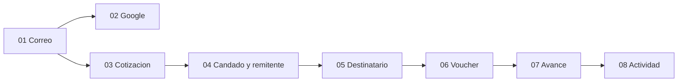

# Tickets Few

Ocho cortes para construir el prototipo descrito en el spec de Few. Cada corte atraviesa datos, operación y pantalla, y se puede demostrar solo. El spec manda si un ticket y el spec chocan.

Hay un solo contrato que las pantallas pueden llamar: cotizar, bloquear, guardar remitente, guardar destinatario, enviar voucher y leer el envío. La interfaz no calcula tipos, plazos ni estados. Los tests de ese contrato usan una base de datos de prueba, un reloj que el test mueve y una sesión inyectada. No se prueba el parecido con Figma ni el inicio de sesión de Google.

El diseño de referencia es el archivo de Figma «Few — Remittances Perú ↔ Europa (Mobile)». La interfaz va en español, sin selector de idioma. Next.js con App Router, en local. Auth, Postgres y el archivo del voucher viven en Supabase. El correo de Auth no exige confirmación.

Queda fuera de todos los tickets: dinero real, licencia, cotejo bancario, panel de operador, el corredor Europa hacia Perú, tipo de cambio en vivo, push, recuperar la contraseña, editar el perfil y datos de ejemplo en una cuenta nueva.



El 02 y el 03 pueden hacerse en paralelo. Los demás esperan a su antecesor.

## 01 — Entrar con correo y barra de Few

**Status:** ready-for-agent

**Blocked by:** None — can start immediately

**Objetivo.** Existir como aplicación con una persona adentro. Sin esto no hay sesión a la que colgar una cotización, y el resto de los cortes no tiene dueño.

**Conexión con lo anterior.** No hay aplicación previa. Este corte deja el cascarón: barra negra, menú y un inicio vacío que saluda «Hola». El corte 03 monta la cotización en ese mismo inicio. No construyas una portada que después haya que tirar.

**Qué se construye.** Una persona crea una cuenta solo con correo y contraseña, entra con esas credenciales y cae en el inicio. El correo no pide confirmación. Entrar dice «¡Qué bueno volver a verte!» y ofrece Continuar con Google, correo, contraseña, Entrar y un enlace a Crear cuenta. Crear cuenta dice «Crea tu cuenta.» y «Transfiere dinero al instante entre Perú y Europa», y su enlace de vuelta dice Ingresar. El botón de Google se ve, pero todavía no entra. Todas las pantallas llevan la barra negra: Few a la izquierda y el menú a la derecha. Sin sesión, el menú abre una hoja corta: cotiza, paga, sube el voucher. Con sesión, muestra el correo y Cerrar sesión, y no repite Inicio ni Actividad. Cerrar sesión devuelve al acceso.

**Qué no entra.** El nombre, el DNI y el celular. La cotización. El saludo con nombre de Google.

- [ ] Se puede crear una cuenta con correo y contraseña, sin documento ni celular, y entrar al momento.
- [ ] Entrar y Crear cuenta muestran los textos de arriba y se enlazan entre sí.
- [ ] Sin sesión, el menú explica cómo funciona y no muestra datos de cuenta.
- [ ] Con sesión, el menú muestra el correo y Cerrar sesión, y no lista Inicio ni Actividad.
- [ ] Cerrar sesión impide volver al inicio sin entrar otra vez.
- [ ] El inicio existente saluda «Hola» y ya tiene la barra negra.

## 02 — Continuar con Google

**Status:** ready-for-agent

**Blocked by:** 01 — Entrar con correo y barra de Few

**Objetivo.** Ofrecer el otro acceso del diseño sin rehacer el correo. El primer nombre de Google queda disponible para el saludo del corte 03.

**Conexión con lo anterior.** El corte 01 ya dibujó Continuar con Google en Entrar y en Crear cuenta, y ya sabe abrir una sesión. Este corte conecta ese botón con Google y guarda el primer nombre de esa cuenta. No cambia el formulario de correo.

**Qué se construye.** Pulsar Continuar con Google, en cualquiera de las dos pantallas, abre sesión y deja a la persona en el mismo inicio que el correo. Si Google entrega un nombre, queda guardado para el saludo. El menú con sesión sigue mostrando el correo de esa cuenta de Google.

**Qué no entra.** Pedir DNI o celular en el registro. El cálculo de la cotización.

- [ ] Continuar con Google entra desde Entrar y desde Crear cuenta, y cae en el inicio.
- [ ] El primer nombre de Google queda disponible para el saludo.
- [ ] El correo y la contraseña del corte 01 siguen funcionando.
- [ ] El menú de esa sesión muestra el correo de Google y Cerrar sesión.

## 03 — Cotizar en el inicio

**Status:** ready-for-agent

**Blocked by:** 01 — Entrar con correo y barra de Few

**Objetivo.** Que el inicio sea la cotización. A partir de aquí una persona ve cuánto llegaría a Europa antes de comprometer un envío.

**Conexión con lo anterior.** El corte 01 dejó el inicio con la barra y el saludo «Hola». Este corte llena ese inicio. No depende de Google: si el corte 02 ya guardó un primer nombre, el saludo lo usa; si no, sigue «Hola». El nombre del remitente todavía no existe y no se inventa.

**Qué se construye.** El inicio dice «¿Cuánto enviamos hoy?». Solo se edita «Tú envías», de S/ 50 a S/ 20,000, con dos decimales. «Ellos reciben», la comisión y el total se calculan. Europa → Perú se ve y no se elige. El país se elige en una hoja sobre el inicio, con buscador y cierre con X. X no cambia el país. Elegir un país cierra la hoja y recalcula.

Los tipos son fijos, en soles por unidad de moneda extranjera: EUR 4.16, CHF 4.45, GBP 4.85. Países: España, Italia, Alemania, Francia, Países Bajos, Portugal, Bélgica e Irlanda en EUR; Suiza en CHF; Reino Unido en GBP. Comisión = 1% del monto enviado. Recibido = monto / tipo. Total = monto + comisión. Todo a dos decimales, half-up. S/ 1,200 a España son €288.46, comisión S/ 12.00 y total S/ 1,212.00.

La barra inferior es Inicio y Actividad, y solo aparece en esas dos pantallas. Actividad está vacía y muestra la tarjeta «Envía dinero a casa» con Cotizar, que vuelve al inicio.

Continuar todavía no bloquea ni abre el remitente. Puede verse deshabilitado hasta el corte 04, o no hacer nada. No crees un envío.

**Qué no entra.** El candado de 15 minutos, la referencia FEW- y el formulario del remitente.

- [ ] Un monto dentro del rango recalcula recibido, comisión y total con las reglas de arriba.
- [ ] Un monto fuera de rango no se puede usar para continuar.
- [ ] Europa → Perú no cambia el corredor.
- [ ] La hoja de país busca entre los diez países, se cierra con X sin cambiar nada, y al elegir recalcula.
- [ ] El saludo es el primer nombre de Google si existe, y «Hola» si no.
- [ ] Actividad, vacía, vuelve al inicio con Cotizar.
- [ ] Estas cuentas viven en el módulo de operaciones, con el reloj y la base de prueba. La pantalla solo muestra lo que ese módulo devuelve.

## 04 — Bloquear la cotización y guardar al remitente

**Status:** ready-for-agent

**Blocked by:** 03 — Cotizar en el inicio

**Objetivo.** Pasar de una cuenta en pantalla a una cotización con dueño y con plazo. El remitente se pide una sola vez porque el prototipo no verifica identidad, pero el envío tiene que saber quién paga.

**Conexión con lo anterior.** El corte 03 ya calcula y ya eligió país. Continuar, que ahí no hacía nada, ahora bloquea esa cotización. El menú del corte 01 gana, en solo lectura, el nombre, el DNI y el celular cuando ya existen. El saludo pasa a usar el nombre del remitente en cuanto se guarda, por delante del nombre de Google.

**Qué se construye.** Continuar congela monto, país y tipo durante 15 minutos y muestra «Tipo bloqueado» con la cuenta atrás. En ese instante nace la referencia `FEW-` y cinco dígitos. Si el perfil no tiene nombre, DNI y celular, Continuar abre «¿Quién envía?», paso 1 de 6, con campos vacíos y ejemplo. El DNI son 8 dígitos. No hay consulta a RENIEC ni SMS. Al guardar, la siguiente vez Continuar salta el formulario. Se puede volver atrás al inicio. El menú muestra esos tres datos en solo lectura y sigue sin poder editarlos.

**Qué no entra.** El destinatario y el voucher. Alargar el candado por visitar el remitente.

- [ ] Continuar crea una cotización bloqueada 15 minutos, con referencia FEW- de cinco dígitos.
- [ ] Sin datos de remitente, Continuar abre el formulario y no deja seguir con un DNI que no tenga 8 dígitos.
- [ ] Con los datos ya guardados, Continuar no vuelve a pedirlos.
- [ ] El menú muestra nombre, DNI y celular en solo lectura, más el correo y Cerrar sesión.
- [ ] El saludo del inicio usa el nombre del remitente guardado.
- [ ] Otra sesión no lee ni escribe este perfil ni esta cotización.
- [ ] El vencimiento se prueba moviendo el reloj, no esperando un cuarto de hora.

## 05 — Elegir o crear destinatario

**Status:** ready-for-agent

**Blocked by:** 04 — Bloquear la cotización y guardar al remitente

**Objetivo.** Atar la cotización bloqueada a una persona y a un IBAN del mismo país. Sin eso el pago no tiene a quién llegar.

**Conexión con lo anterior.** El corte 04 dejó una cotización vigente, un país y un remitente. Este corte es el paso 2 de 6 y solo ofrece destinatarios de ese país. Volver atrás regresa al remitente o al inicio según los datos ya existan, sin reiniciar los 15 minutos.

**Qué se construye.** Si hay destinatarios guardados de ese país, se ve la lista, uno marcado, y el botón oscuro «Nuevo destinatario». Ese botón cambia a un formulario y oculta la lista. El formulario pide nombre e IBAN. El nombre es obligatorio. El IBAN se valida por formato, dígito de control y prefijo del país cotizado. Uno válido se guarda en la cuenta y queda elegido. Uno de otro país, o inválido, no deja continuar. Continuar lleva a la pantalla de pago del corte 06, que puede ser un lugar vacío hasta ese corte, pero la elección del destinatario ya queda persistida.

**Qué no entra.** Mostrar la lista y el formulario a la vez. Subir el voucher.

- [ ] Solo aparecen destinatarios del país de la cotización bloqueada.
- [ ] «Nuevo destinatario» sustituye la lista por el formulario.
- [ ] Un IBAN válido del país se guarda y queda elegido.
- [ ] Un IBAN inválido o de otro país no deja continuar.
- [ ] Elegir destinatario no mueve el instante en que vence el candado.
- [ ] Otra sesión no ve estos destinatarios.

## 06 — Pagar y enviar el voucher

**Status:** ready-for-agent

**Blocked by:** 05 — Elegir o crear destinatario

**Objetivo.** Crear el envío solo cuando hay una cotización vigente, un remitente, un destinatario y un archivo. Ese es el momento en que el prototipo deja de ser una cuenta y pasa a ser una transferencia.

**Conexión con lo anterior.** Usa la cotización bloqueada del corte 04 y el destinatario elegido en el corte 05. La referencia que nació al continuar se muestra aquí, no se inventa otra. El archivo queda guardado para el corte 07, que solo va a leer la hora de envío.

**Qué se construye.** Paso 3 de 6, «Paga y envía.». Se ve el total exacto, Few Peru S.A.C., la cuenta `000-0000000-0-00` y la referencia de esa cotización. Se puede volver atrás. Enviar voucher exige un JPG, PNG o PDF de hasta 10 MB. Sin archivo, con un archivo que no cumple, o con el candado ya vencido, no se crea el envío. Si venció, se vuelve a cotizar. Si cumple, se crea el envío con esa cotización, ese remitente, ese destinatario y ese archivo, y se anota la hora. El servidor guarda el archivo en un almacén privado y no lee su contenido. No hay cotejo contra un banco.

**Qué no entra.** Avanzar solo a «el dinero ya va». Eso es el corte 07.

- [ ] La pantalla muestra el total, la cuenta fija y la referencia creada al continuar.
- [ ] Sin archivo válido no hay envío.
- [ ] Con el reloj pasado de los 15 minutos, Enviar voucher no crea el envío y devuelve a cotizar.
- [ ] Con archivo válido y candado vigente, el envío queda creado y el archivo guardado a nombre de esa persona.
- [ ] Otra sesión no lee ese archivo ni ese envío.

## 07 — Ver el envío avanzar hasta confirmado

**Status:** ready-for-agent

**Blocked by:** 06 — Pagar y enviar el voucher

**Objetivo.** Hacer visible que el dinero es simulado pero el estado es real: revisión, camino y confirmado salen de la hora en que se envió el voucher, no de un operador ni de una cola.

**Conexión con lo anterior.** El corte 06 ya creó el envío y guardó la hora. Este corte no vuelve a subir el archivo ni reabre el candado. Solo lee.

**Qué se construye.** El estado se calcula al leer:

```
0s–20s    revisión
20s–40s   envío en curso
40s+      confirmado
```

En revisión se ve «Revisando tu voucher.», con remitente, destinatario y pago en Listo, revisión En curso y envío Pendiente. En camino, el fondo es lima, la revisión pasa a Listo y el envío a En curso, con el monto y el destinatario. En confirmado se ven destinatario, enviado, comisión, recibido, referencia bancaria y fecha. Esos tres pantallas no tienen flecha atrás. Si la revisión o el camino siguen abiertos, la pantalla vuelve a leer cada pocos segundos y pasa sola al siguiente estado. Cerrar la pestaña no detiene el reloj: al volver, el estado es el que corresponde a la hora.

**Qué no entra.** Actividad, el PDF y Enviar de nuevo.

- [ ] A los 0, 20 y 40 segundos el mismo envío se lee como revisión, en curso y confirmado.
- [ ] La pantalla abierta cambia sola al cruzar esos instantes.
- [ ] Leer después de cerrar la sesión y volver muestra el estado que ya toca.
- [ ] Confirmado muestra los datos de la cotización y del destinatario, no un cálculo nuevo.
- [ ] Revisión, envío y confirmado no ofrecen volver atrás.

## 08 — Actividad, enviar de nuevo y recibo

**Status:** ready-for-agent

**Blocked by:** 07 — Ver el envío avanzar hasta confirmado

**Objetivo.** Cerrar el ciclo: el envío se puede retomar, repetir y guardar. Actividad deja de ser la pantalla vacía del corte 03 y pasa a ser el historial de esa persona.

**Conexión con lo anterior.** Lee los envíos que el corte 06 creó y que el corte 07 sabe fechar. Enviar de nuevo no reabre la cotización vieja: arma una nueva con el mismo destinatario y el mismo monto, y el bloqueo vuelve a ocurrir al pulsar Continuar, con las reglas del corte 04. Cotizar, en la tarjeta de Actividad, sigue volviendo al inicio vacío de persona y monto, como en el corte 03.

**Qué se construye.** Actividad lista los envíos de la sesión, del más nuevo al más antiguo. Revisión y envío en curso se ven como Verificando. Confirmado solo cuando ya pasaron los 40 segundos. Una cotización caducada sin voucher no aparece. Una fila abre el paso en el que está ese envío. La tarjeta «Envía dinero a casa» se queda debajo de la lista. Enviar de nuevo, en un envío confirmado, vuelve al inicio con ese destinatario y ese monto ya puestos. El recibo es un PDF en español, solo si el envío está confirmado, con destinatario, enviado, comisión, recibido, referencia bancaria y fecha.

**Qué no entra.** Un historial de muestra para cuentas nuevas. Esas siguen viendo la lista vacía y la tarjeta.

- [ ] Actividad muestra solo envíos creados, del más nuevo al más antiguo, con Verificando o Confirmado según el reloj.
- [ ] Una cotización sin voucher no sale en la lista.
- [ ] Abrir una fila lleva a revisión, a envío o a confirmado según la hora.
- [ ] Enviar de nuevo deja el mismo destinatario y el mismo monto en una cotización nueva, que se bloquea otra vez al continuar.
- [ ] El PDF existe solo para un envío confirmado y trae los datos de esa confirmación.
- [ ] Otra sesión no ve esta lista ni descarga este recibo.
